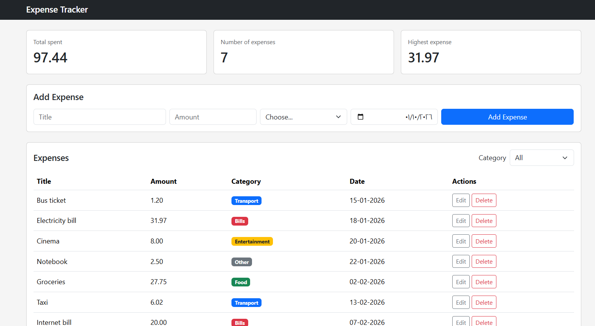
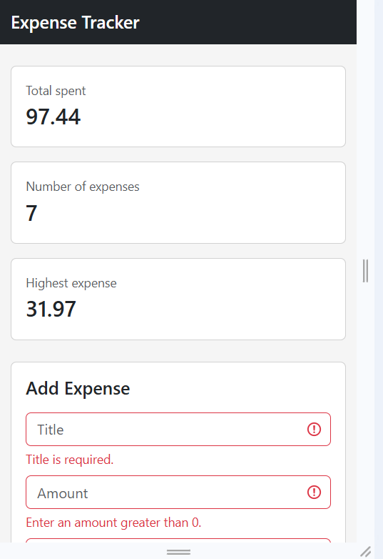

# Expense Tracker

<!-- Write 1-2 sentences: what does your app do? -->
A web app for tracking personal expenses, with a Node.js/Express/PostgreSQL backend and a Bootstrap frontend. Add, edit, delete, and filter expenses, and see a live summary of your total spending, number of expenses, and highest expense.

## How to run

<!-- Write the exact steps someone needs to run your project from scratch.
     Assume they have Node.js, PostgreSQL, and VS Code, and nothing else.
     Include: creating the database, running schema.sql, writing the .env file,
     starting the backend, and opening the frontend. -->

**Backend**

 1. Open pgAdmin and create a new, empty database named `expense_tracker`.
2. Open the Query Tool on that database and run the `schema.sql` file (found in the `backend` folder). This creates the `expenses` table.
3. In the `backend` folder, copy `.env.example` to a new file named `.env`, and write your PostgreSQL password in the `DB_PASSWORD` field.
4. Open a terminal in the `backend` folder and run:npm install
5. Start the server:node server.js

**Frontend**

1. Open the `frontend` folder in VS Code.
2. Right-click `index.html` and choose **Open with Live Server**.
3. The app will open in your browser and load the expenses from the backend automatically.

## Features

<!-- List what your app can do. Tick what you finished. -->

- [ ] Add an expense (with validation)
- [ ] Delete an expense
- [ ] Edit an expense
- [ ] Filter by category
- [ ] Summary cards (total, count, highest)
- [ ] Data is saved in a PostgreSQL database

## Screenshots

<!-- Add 2-3 screenshots of your app (desktop and mobile). -->

## What was the hardest part?

<!-- A short paragraph: what got you stuck, and how did you solve it? -->
